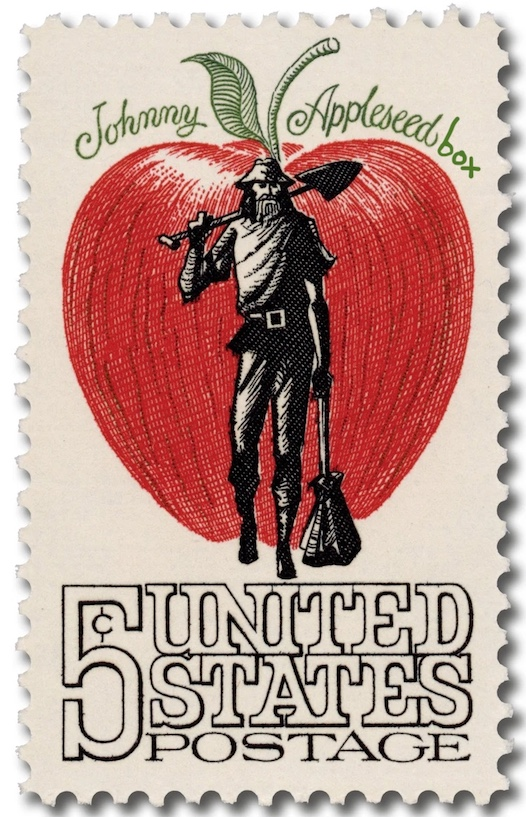

# johnny-appleseedbox

A privacy-first seedbox, for running locally or in the cloud.

## Oi, what are you on about here??

[Seedboxes](https://en.wikipedia.org/wiki/Seedbox) are a popular way in P2P setups (e.g. BitTorrent) to have a dedicated system share (seed) content (also can download content) separately of your other systems. This can be nice for a numbe of reasons, including reducing load on your 'daily driver' systems, separation of activity off your home network (when hosted in the cloud or elsewhere), and more.

This initial swag at a README describes the pieces involved, with supporting files added soon.

## The goals of this project

Loosely gathered in no particular order:

* runs on both baremetal OR in a VM (or maybe in a container!)
* runs local or in a cloud provider
* uses a security-focused OS
* "always on" VPN that fails open (i.e. no traffic allowed through) in any adverse/unexpected conditions
* VPN provider as least shady as possible AND supports port forwarding (not many services support that these days)
* seeds torrents without any regular intervention needed

## The pieces!

Using a secure OS:

* [Alpine Linux](https://www.alpinelinux.org/)

Non-toxic VPN (hopefully) AND support port forwarding: 

* [AirVPN](https://airvpn.org/)

Reliable TUI or cmdline torrent software:

* [rtorrent](https://rtorrent.net/)
